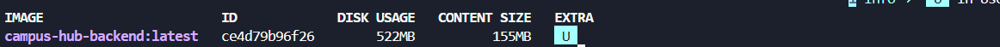
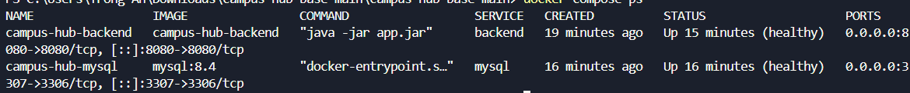
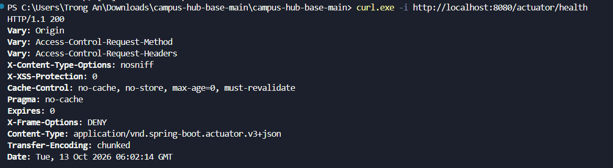

# Campus Hub Base

Mini Project Session 13 — Spring Boot + MySQL (Docker), React frontend (chạy dev riêng).

## 1. Thông tin sinh viên

- Họ tên: **DINH TRONG AN**
- Lớp: **CNTT1**
- Mã sinh viên: **[Điền mã sinh viên]**

## 2. Lệnh chạy hệ thống

Yêu cầu: Docker Desktop đang chạy, đã copy `.env.example` thành `.env` (mặc định `DB_PASSWORD=123456` cho môi trường thực hành).

```powershell
# Kiểm tra cấu hình Compose
docker compose config

# Build image backend + khởi động MySQL và backend
docker compose up -d --build

# Xem trạng thái service
docker compose ps
docker images campus-hub-backend
```

Build riêng image backend (nếu cần minh chứng build):

```powershell
cd backend
.\gradlew.bat test
cd ..
docker build -t campus-hub-backend ./backend
```

Dừng hệ thống:

```powershell
docker compose down
# Xóa cả dữ liệu MySQL nếu cần:
# docker compose down -v
```

## 3. Cổng / URL kiểm tra backend

- Backend: `http://localhost:8080` (Compose map `8080:8080`, `SERVER_PORT=8080`)
- Health check: `http://localhost:8080/actuator/health`
- MySQL (host): `localhost:3307` (map về `3306` trong container)

```powershell
Invoke-RestMethod http://localhost:8080/actuator/health
# Kết quả mong đợi: status = UP, ví dụ {"status":"UP","groups":["liveness","readiness"]}
```

Tài khoản mẫu: `student` / `student123`, `admin` / `admin123`.

## 4. Minh chứng

Ảnh trong thư mục `image/`, đối chiếu được với `compose.yml` và source code:

| # | Nội dung | Lệnh tái hiện | File ảnh |
|---|---|---|---|
| 1 | Docker image build thành công (`campus-hub-backend`) | `docker images campus-hub-backend` | `image/docker-image.png` |
| 2 | Trạng thái service sau khi chạy Compose (cả 2 container `healthy`) | `docker compose ps` | `image/compose-services.png` |
| 3 | Kết quả gọi `/actuator/health` trả về `UP` | `Invoke-RestMethod http://localhost:8080/actuator/health` | `image/health.png` |

### 1. Docker image đã build thành công



### 2. Trạng thái các service sau khi chạy Compose



### 3. Kết quả gọi `/actuator/health`


